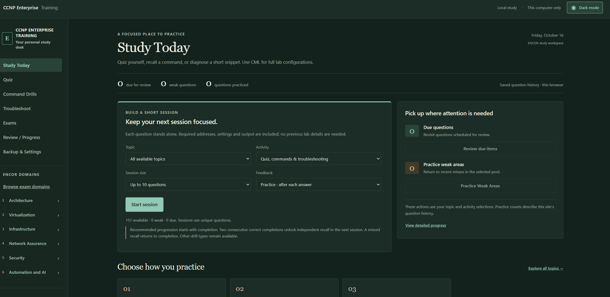
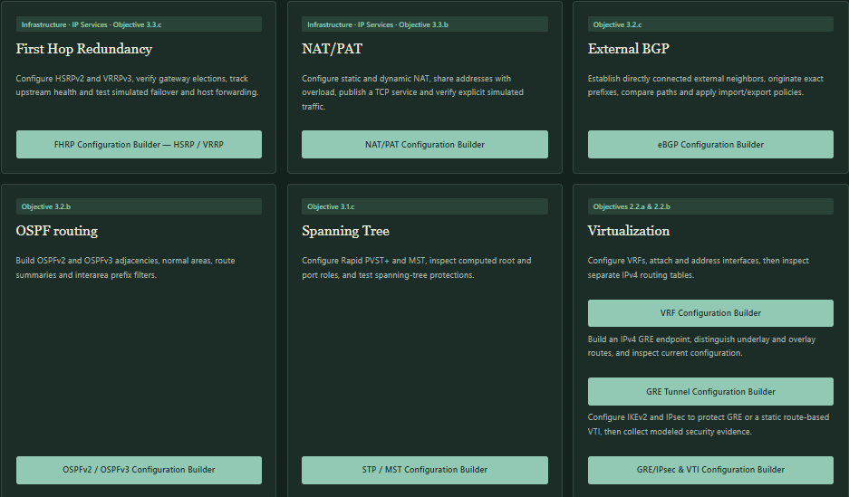
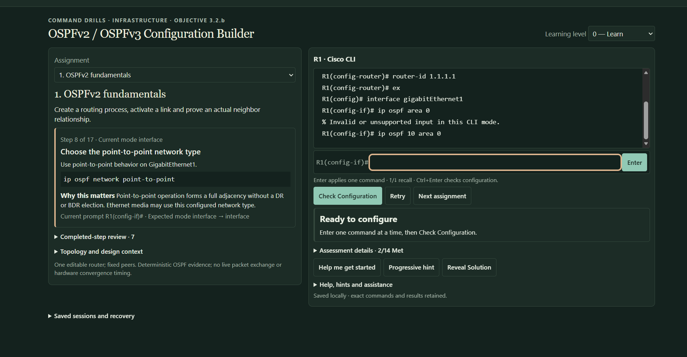
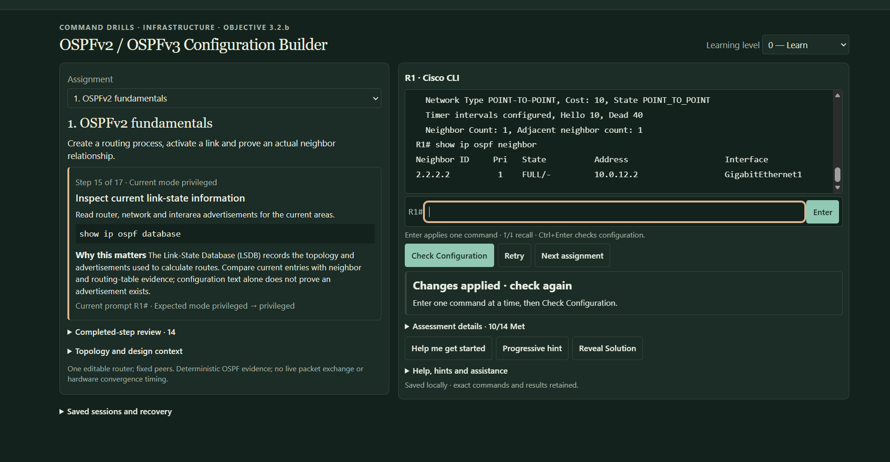
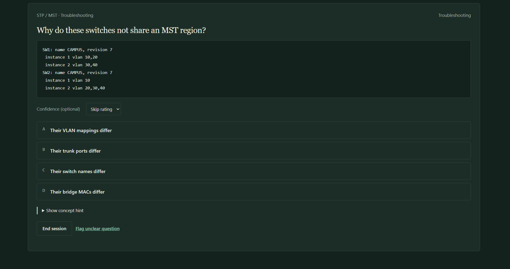

# CCNP Enterprise Trainer — Interactive Network Engineering Training Platform

My CCNP Enterprise preparation is part of a continuing commitment to networking education. I created this private, browser-based trainer to experiment with study methods that combine short, repeatable exercises with separate hands-on practice in Cisco Modeling Labs (CML). The trainer provides deterministic Cisco-style CLI exercises, troubleshooting scenarios, and verification-focused practice.

**My role:** Network engineering requirements, protocol scenario design, technical acceptance criteria, validation planning, testing review, and project ownership, supported by AI-assisted software development workflows.

This showcase documents how I use the trainer to support my networking studies. The application source remains private; this showcase does not distribute the trainer or provide a public application demo.

[Technical overview](docs/technical-overview.md)

## Why I built it

I use different practice formats to revisit networking concepts and connect them with configuration, operational evidence, and troubleshooting. The trainer gives me a way to repeat a focused exercise—interpret a requirement, enter supported commands, inspect modeled evidence, and reason through a fault—as part of my CCNP Enterprise preparation.

CML provides a separate environment for hands-on experimentation with virtual Cisco network operating systems. I use the trainer for shorter modeled exercises and CML to explore device and protocol behavior in a lab. Combining these approaches lets me experiment with how I study while continuing to develop my networking understanding.

## Application overview

| Area | What the learner does |
| --- | --- |
| **Study Today** | Select topics and activities, follow structured practice sessions, and review local progress across ENCOR learning domains. |
| **Command Drills** | Work through configuration objectives in a modeled CLI with mode awareness, supported syntax validation, and configuration and verification tasks. Guided, independent, and challenge-style workflows support different levels of assistance. |
| **Troubleshooting** | Interpret configuration and operational evidence, choose a diagnosis, and review protocol-specific explanations and feedback. |
| **Assessment and progress** | Receive automated feedback on supported exercises, retain local study history, and use session resumption, recovery, and versioned history or replay where supported. |

The CLI processes a bounded set of commands through deterministic simulation rules. Its responses and operational evidence are modeled by the application; learners are not connected to a running Cisco operating system.

## Screenshot gallery

These screenshots follow a learner from study selection through configuration, modeled verification, and troubleshooting. The OSPF captures show work in progress; their step and assessment counters do not indicate a completed assignment. Use the full-size links to view each gallery image at its full available resolution.

### Study Today



Structured CCNP Enterprise practice across six examination domains, with topic selection, review scheduling, and locally maintained progress. [View full-size dashboard](assets/screenshots/study-dashboard.png).

### Configuration Builder catalog



A selection of completed builders for routing, switching, network services, segmentation, and tunneling. This cropped view shows part of the catalog; the builder examples below provide broader context. [View full-size catalog selection](assets/screenshots/configuration-builders.png).

### OSPF syntax validation



The modeled Cisco-style CLI rejects an unsupported OSPF command and accepts the corrected interface-level configuration. The command history, error message, and exercise context are preserved. [View full-size syntax example](assets/screenshots/ospf-cli-validation.png).

### OSPF operational verification



The trainer generates deterministic OSPF operational evidence, allowing learners to inspect neighbor information and verify the expected simulated adjacency state, shown here as `FULL/-`. This output is modeled rather than produced through live OSPF packet exchanges. [View full-size modeled verification](assets/screenshots/ospf-verification.png).

### MST troubleshooting



The learner compares switch configurations with matching region names and revisions but inconsistent VLAN-to-instance mappings. VLAN 20 belongs to instance 1 on SW1 and instance 2 on SW2. The image presents the diagnostic question; it does not show a submitted answer or successful remediation. [View full-size MST evidence](assets/screenshots/mst-troubleshooting.png).

## Configuration Builders

The builders documented below cover routing, switching, tunneling, network services, monitoring, and automation technologies relevant to the CCNP Enterprise ENCOR 350-401 v1.2 blueprint within each exercise's supported scope.

| Engineering area | Completed builders |
| --- | --- |
| Routing and network services | OSPFv2 / OSPFv3; external BGP; NAT/PAT |
| Switching and redundancy | Spanning Tree, Rapid PVST+, and MST; HSRP/VRRP |
| Tunneling and segmentation | VRF-Lite; GRE tunneling; GRE/IPsec and IPsec Virtual Tunnel Interfaces |
| Monitoring | Flexible NetFlow; SPAN/RSPAN/ERSPAN |
| Automation and configuration artifacts | JSON file construction; Embedded Event Manager (EEM) applets |

Each builder provides scoped construction and verification practice. Inclusion here does not imply complete protocol emulation, support for every platform command, or exhaustive exam coverage.

## Engineering workflow: OSPF configuration

An OSPF assignment asks the learner to create a routing process, configure an interface, and perform supported modeled verification. The following command excerpts illustrate the assignment; they are not a complete session transcript. Navigation between excerpts is omitted.

Process configuration:

```text
R1> en
R1# conf t
R1(config)# router ospf 10
R1(config-router)# router-id 1.1.1.1
```

Interface configuration:

```text
R1(config)# in g1
R1(config-if)# ip ospf 10 area 0
R1(config-if)# ip ospf network point-to-point
R1(config-if)# ip ospf cost 10
```

The modeled CLI rejects an incorrect interface command with this response:

```text
ip ospf area 0
% Invalid or unsupported input in this CLI mode.
```

The learner corrects the command to:

```text
ip ospf 10 area 0
```

This example connects requirements to configuration modes, process and interface settings, syntax feedback, and corrective action. The omitted process identifier matters in this supported interface command. Verification is a separate learning step: the gallery shows simulated neighbor output, while the exercise remains in progress. Neither the excerpts nor the screenshot establish a live OSPF adjacency or completed assignment.

## Troubleshooting through evidence

**MST region mismatch:** Two switches have identical region names and revision numbers but different VLAN-to-instance mappings. The learner must compare the mappings to explain why the switches do not belong to the same MST region. The exercise practices configuration analysis beyond checking matching labels.

**GRE recursive routing:** The route to a tunnel endpoint resolves through the GRE tunnel itself. The learner must trace that dependency, identify the recursive routing fault, and recognize the need for an independent underlay route. The scenario practices route interpretation and fault isolation; no successful remediation output is claimed here.

The gallery's MST screenshot shows the configuration evidence for the first scenario. The GRE scenario is presented here as a text example.

## Technical approach and validation

The application uses HTML, CSS, and JavaScript and operates locally in a browser without requiring a public backend. Deterministic networking rules support the modeled CLI, scenario evidence, and assessment of supported exercise objectives. Local progress supports continued study across sessions.

My development workflow uses technical requirements, acceptance criteria, testing expectations, iterative review, and Git/GitHub version control. Supported command handling, expected configuration changes, modeled operational behavior, and exercise outcomes are subjects of application validation.

These three kinds of evidence have different meanings:

| Environment or activity | What it can establish |
| --- | --- |
| **Modeled trainer exercises** | How the learner interacts with supported commands, configuration state, simulated evidence, and exercise feedback. |
| **Automated application tests** | Whether tested trainer behavior matches its defined expectations and whether tested behavior regresses. Passing tests does not establish complete IOS XE compatibility. |
| **Separate CML experimentation** | Hands-on observations from virtual Cisco operating systems in the particular lab being run. This showcase does not claim every trainer exercise has a corresponding independently validated CML topology. |

No new application tests or CML sessions were run to prepare this documentation. See the [technical overview](docs/technical-overview.md) for the exercise design and evidence boundaries.

## Engineering skills demonstrated

| Project work | Engineering skill made visible |
| --- | --- |
| Define routing, switching, tunneling, and monitoring assignments | Translate networking requirements into concrete configuration objectives. |
| Design MST and GRE fault scenarios | Select evidence that supports protocol analysis and fault isolation. |
| Specify accepted commands, correction behavior, and verification tasks | Connect configuration intent with observable, testable expectations. |
| Review implementation and regression behavior | Apply structured testing and iterative technical review. |
| Maintain scope, documentation, and development history | Practice project planning, software-assisted engineering, and long-term ownership. |

## My contribution

I currently work as a Network Engineer and am studying for CCNP Enterprise. My existing certifications are Cisco CCNA and CompTIA A+, Network+, Security+, CySA+, and PenTest+.

I designed and directed the trainer's development through networking requirements, technical scenarios, acceptance criteria, testing expectations, technical validation, and iterative development review. I used AI-assisted coding workflows for implementation; I do not claim to have manually authored every line of application code. My contribution centers on the engineering specifications, scenario design, review, and ownership that guide the project.

## Scope and limitations

The CLI models supported Cisco-style interactions. It is not a complete IOS XE emulator, a live router or switch, a packet-level simulator, or a full topology emulator. The trainer complements CML and real network experimentation.

The full application remains private. I use this showcase to document the trainer's capabilities and present five authentic application screenshots. There is no implied Cisco sponsorship, endorsement, or official affiliation, and this material is not official examination content.
